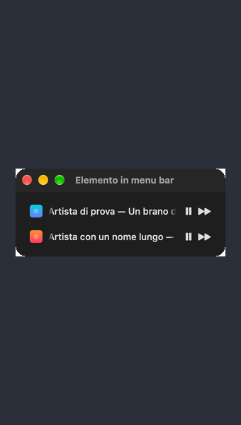

# OpenTunes

> Nome provvisorio.

App macOS open source che mostra il brano in riproduzione (Apple Music, Spotify, YouTube nel browser e
qualsiasi player che pubblica il Now Playing di sistema) e permette di controllarlo.

**Stato: v0.3** — fase 3: widget di macOS, widget live sulla scrivania, player nel notch, copertina nel Dock.



## Superfici

| Superficie | Cosa mostra | Dove si attiva |
| --- | --- | --- |
| **Menu bar** | copertina, titolo con formato personalizzabile e scorrevole, pulsanti, love; modalità compatta accanto al notch | sempre |
| **Popover** | copertina grande, avanzamento con seek, shuffle/repeat, volume, ultimi brani, profilo Last.fm | clic sulla menu bar |
| **Finestra flottante** | player Liquid Glass compatto o grande, sempre in primo piano | Impostazioni › Generali |
| **Widget di macOS** | tre taglie (piccola, media, grande con ascolti recenti e top artisti Last.fm), pulsanti play/pausa, salto e love | Centro notifiche o scrivania › Modifica widget |
| **Widget live sulla scrivania** | copertina, titolo, controlli, avanzamento in tempo reale, grafico Last.fm opzionale; tre layout, ridimensionabile, bloccabile | Impostazioni › Superfici |
| **Notch** | chiuso: copertina a sinistra e indicatore a destra; aperto (passaggio del mouse o clic): titolo, controlli, avanzamento; titolo per qualche secondo a ogni cambio brano. Sui Mac senza notch: capsula di vetro nella menu bar | Impostazioni › Superfici (disattivabile, es. se usi Boring Notch) |
| **Dock** | copertina del brano come icona | Impostazioni › Superfici |
| **HUD e notifiche** | cambio brano, volume, love, cambio player | Impostazioni › Generali |

Tutte le superfici usano il vetro di sistema tinto con il colore della copertina (disattivabile).

## Funzioni

- **Menu bar**: copertina, titolo con formato personalizzabile (`{artist} — {title}`, solo titolo, …) che scorre
  se è troppo lungo, pulsanti. Elementi riordinabili, controlli anche come elemento separato.
  Modalità compatta automatica quando lo spazio accanto al notch non basta.
- **Azioni del mouse** configurabili: clic sinistro (player), centrale (play/pausa), destro (menu rapido), rotella (volume o seek).
- **HUD** al cambio brano e volume, **notifiche** con copertina, **scorciatoie globali**, avvio al login.
- Player da ignorare (es. Zoom), pulizia dei titoli di YouTube, copertine mancanti cercate su iTunes (disattivabile).
- **Scrobbling** su Last.fm e/o ListenBrainz da qualsiasi player: regola standard (metà brano o 4 minuti,
  soglia personalizzabile), la pausa non azzera il tempo, un invio per ascolto, `now playing` a ogni brano.
  Coda offline (SwiftData) con invio a blocchi e nuovi tentativi; indicatore in menu bar se ci sono ascolti in coda.
  Browser esclusi di default; ogni player si può includere o escludere.
- **Scrobble puliti**: via «(Remastered 2011)», «- Radio Edit», «[Official Video]», «feat. …» (opzionale),
  album artist delle compilation, con anteprima nelle impostazioni.
- **Love** su Last.fm (anche come preferito in Musica), **stelle, dislike e aggiungi alla libreria** per Apple Music,
  dal popover, dalla finestra flottante, dal notch, dai widget, dal menu rapido, dalla menu bar e con scorciatoie;
  **cambia player attivo**.
- **Profilo Last.fm** nel popover (scrobble recenti, brani amati, top artisti), in cache per 10 minuti.
- Cronologia degli ascolti salvata tra un avvio e l'altro.
- **App Intents**: play/pausa, brano successivo/precedente e love sono disponibili anche in Comandi Rapidi.

## Confronto con NepTunes

OpenTunes nasce come alternativa libera a [NepTunes](https://neptunesmac.app). Il confronto si basa sulla pagina
pubblica di NepTunes (novembre 2026) e può non essere aggiornato.

| | OpenTunes | NepTunes |
| --- | --- | --- |
| Licenza | GPL-3.0, codice aperto | proprietaria |
| Prezzo | gratis | versione gratuita + Pro a pagamento |
| Scrobbling Last.fm e ListenBrainz | sì | sì |
| Scrobble puliti | sì | Pro |
| Player supportati | qualsiasi player del Now Playing di sistema, browser compresi | vedi il loro sito |
| Widget sulla scrivania | widget live nativo (3 layout) + widget di macOS | galleria di widget HTML (Pro) |
| Copertina nel Dock | sì | sì |

Non affiliato a NepTunes né ad Apple.

## Installazione

Scarica il `.dmg` dalla [pagina delle release](../../releases), trascina OpenTunes in Applicazioni e,
finché l'app non è notarizzata, togli la quarantena:

```sh
xattr -dr com.apple.quarantine /Applications/OpenTunes.app
```

Con Homebrew (tap personale, vedi `packaging/homebrew/`): `brew install --cask Akiakizero/tap/opentunes`.

## Widget e App Group

I widget di macOS leggono lo stato del brano da un App Group condiviso con l'app (`<Team ID>.org.opentunes.shared`).
Le build ufficiali sono firmate ad-hoc: se il widget resta su «Niente in riproduzione», compila l'app con il tuo
Team ID (`DEVELOPMENT_TEAM=XXXXXXXXXX` nella riga di `xcodebuild`), così macOS riconosce l'App Group senza chiedere conferme.

## Requisiti

- macOS 26 o successivo
- Xcode 26 o successivo, [XcodeGen](https://github.com/yonaskolb/XcodeGen) (`brew install xcodegen`)

## Build

```sh
xcodegen generate
xcodebuild -scheme OpenTunes -destination 'platform=macOS' test
```

La build compila automaticamente l'adapter MediaRemote dai sorgenti in `Vendor/mediaremote-adapter/`.
`scripts/make-dmg.sh` crea il `.dmg` in `dist/`; il workflow `Release` lo allega alla release a ogni tag `v*`.

## Come funziona

Da macOS 15.4 le app di terze parti non possono più leggere direttamente il Now Playing di sistema.
OpenTunes usa [mediaremote-adapter](https://github.com/ungive/mediaremote-adapter), che passa da
`/usr/bin/perl`. Se l'adapter non funziona, l'app passa da sola ad AppleScript per Apple Music e Spotify
(e chiede il permesso Automazione).

## Last.fm e la API key

Last.fm richiede a ogni app una API key e una *shared secret*. In un'app open source la secret non può restare
segreta: chiunque la estragga dall'app la può usare. È la stessa situazione di tutti gli scrobbler open source.
Per questo:

- le build ufficiali includono la chiave del progetto (segreti `LASTFM_API_KEY` e `LASTFM_API_SECRET`
  del workflow di release); chi compila da sé ottiene un'app senza chiave;
- in Impostazioni › Scrobbling › «Usa una API key personale» puoi inserire la tua
  ([crea una chiave](https://www.last.fm/api/account/create)); la secret va nel Portachiavi.

L'accesso avviene nel browser (flusso desktop di Last.fm): OpenTunes non vede mai la tua password.
La session key e il token di ListenBrainz sono salvati nel Portachiavi. Le build non firmate con un certificato
possono far comparire la richiesta di accesso al Portachiavi dopo ogni aggiornamento: scegli «Consenti sempre».

## Licenza

GPL-3.0-or-later. Vedi [LICENSE](LICENSE) e [CREDITS.md](CREDITS.md).
